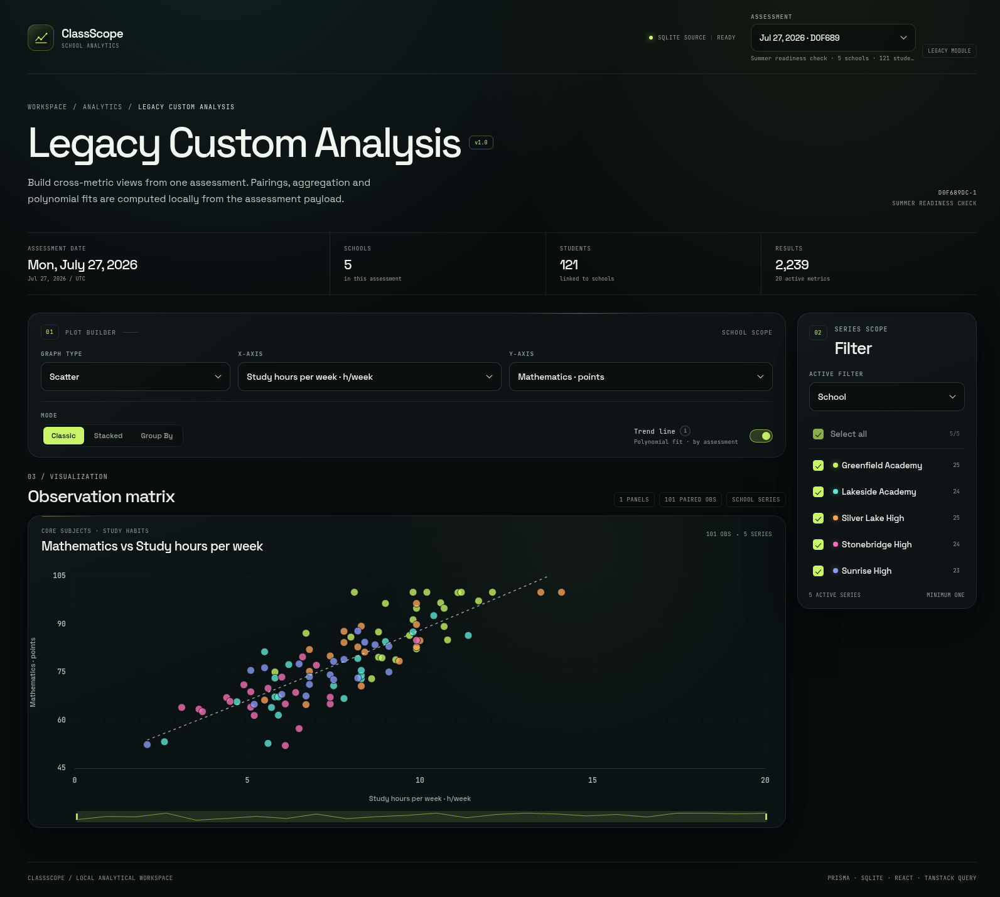
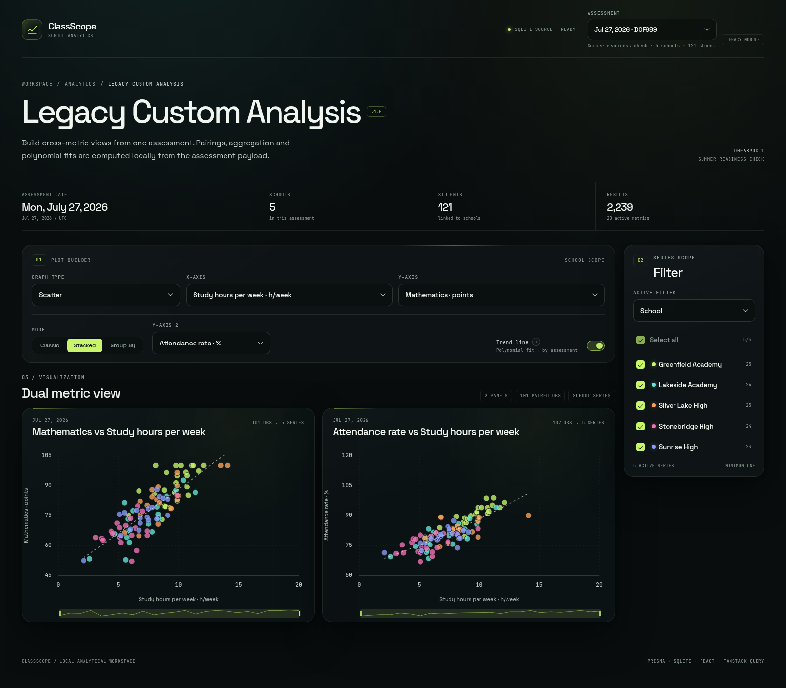
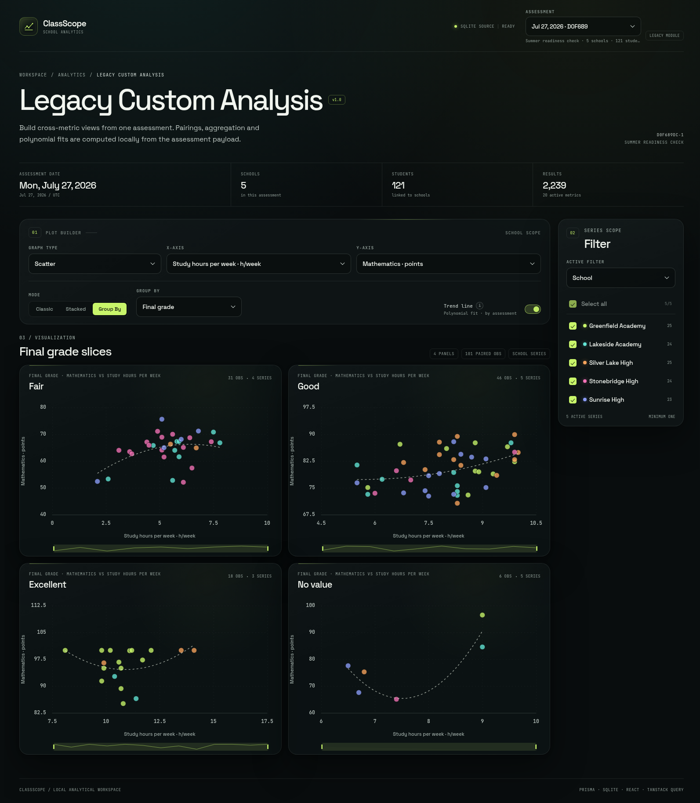
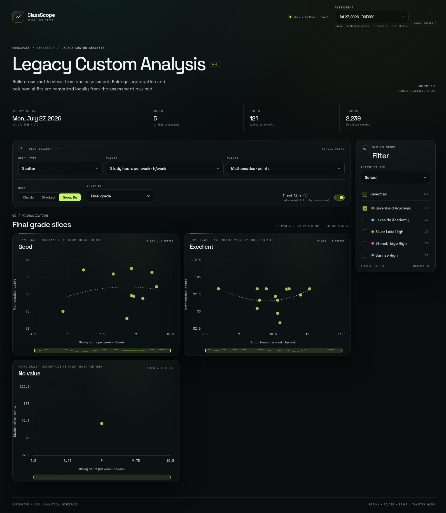
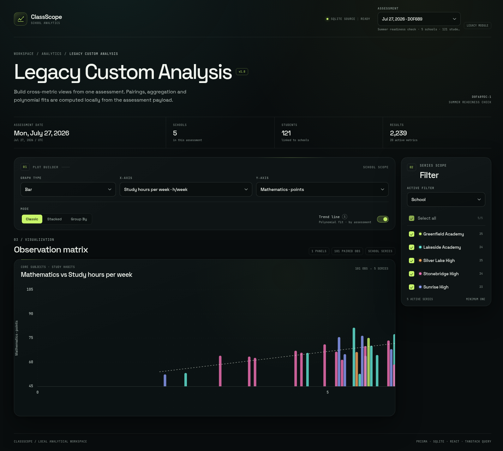
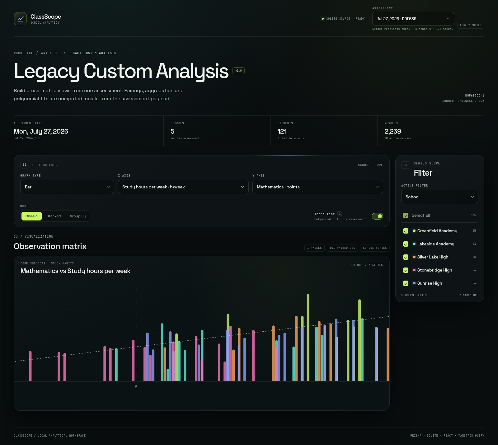
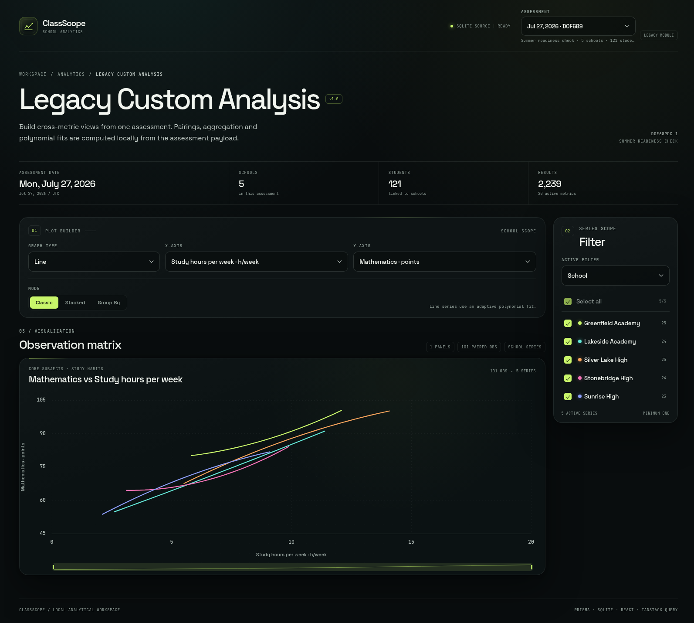
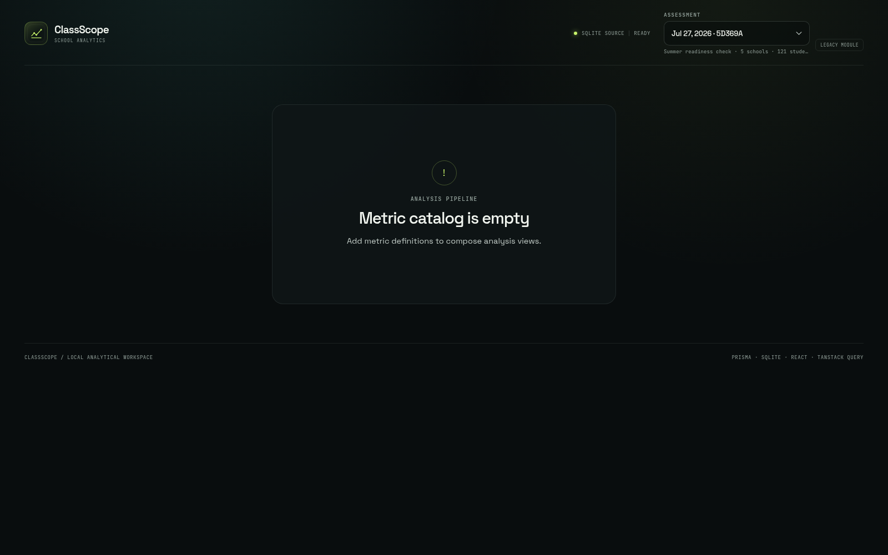

# ClassScope

ClassScope is a local analytics workspace for school assessment data. It keeps the original "Legacy Custom Analysis" idea: choose one assessment, pair two metrics on the X and Y axes, switch between chart types and aggregation modes, and filter series by school or class.

The repository contains a TypeScript Fastify API, a Prisma/SQLite database, a deterministic seed, and a React frontend built with Vite, TanStack Query, Zustand, and ECharts.

## Data model

- `Assessment`: one dated assessment (`assessedAt`, `title`, `notes`).
- `School`: belongs to an assessment (`name`, `city`).
- `Class`: belongs to a school (`name`, `description`).
- `Student`: belongs to a school and optionally to a class (`code`).
- `Metric`: metric catalog entry (`code`, `name`, `description`, `unit`, `valueType`, `category`, `decimals`, `minValue`, `maxValue`, `isActive`).
- `MetricOption`: ordered allowed values for text metrics.
- `Result`: one value for one student and one metric (`numericValue` or `textValue`).

Seed data is deterministic: 10 assessments, 5-15 schools per assessment, 3-4 classes per school, 20-30 students per school, about 3% of students without a class, and 17-20 metrics per student. Numeric metrics are correlated; text metrics are derived from the numeric values.

## Metric catalog

Subject scores (0-100): Mathematics, Physics, Literature, English, Informatics, Chemistry, Biology, History, Geography.

Numeric indicators: Attendance rate, Homework completion, Study hours per week, Absences, Participation index, Reading speed, Sleep hours.

Ordered text metrics: Final grade (Poor, Fair, Good, Excellent), Engagement (Low, Medium, High), Risk level (Low, Medium, High), Exam readiness (Not ready, Partial, Ready).

## API

- `GET /api/assessments` - short assessment list (`id`, `assessedAt`).
- `GET /api/assessments/:id` - assessment tree; each result contains only `id`, `metricId`, `numericValue`, and `textValue`.
- `GET /api/assessments/:id/filter-options` - school and class options.
- `POST /api/assessments` - submit a nested assessment; the response is a short assessment summary.
- `GET /api/metrics` - metric catalog with ordered `allowedValues`.
- `GET /health` - health check.

## Run

```bash
npm install
npm --prefix frontend install
npm run db:setup
npm run dev:all
```

`dev:all` starts the API and the Vite frontend together. To run them separately, use `npm run dev` and `npm run dev:web` in two terminals.

Open `http://127.0.0.1:5173/`. The Vite development server proxies `/api` to the backend on `http://127.0.0.1:3000`.

Useful commands:

```bash
npm run db:seed
npm run db:studio
npm run dev:all
npm run typecheck
npm test
npm run build
npm --prefix frontend run typecheck
npm --prefix frontend test
npm --prefix frontend run build
```

The backend suite includes integration tests that submit and read assessments with 20,000 and 60,000 results. The frontend suite checks axis ticks, bar scrolling, group-by panel filtering, trend aggregation, assessment switching, and the empty metric catalog state.

## Chart behavior

- Numeric X/Y axes use five nice ticks; axis bounds are selected from nice values with at least 10% padding from the data. Zero-based data is clamped to a zero lower bound.
- Text metric axes use ordered category values from the metric catalog. A single-category text Y axis is rendered with a real value tick and an empty spare tick.
- `Line` draws adaptive polynomial fits without point markers.
- `Bar` uses a true numeric X axis. When the chart is wider than its panel, it scrolls horizontally; the mouse wheel scrolls the bars instead of zooming. The scroll position is preserved when filters change.
- `Stacked` renders two separate charts and a second metric selector. Selecting the same metric for Y and Y-Axis 2 shows a visible warning instead of a silent fallback.
- `Group By` renders one chart per slice. Slices without selected series are removed, and text slices are capped at eight values with an `Other` slice.
- Filter changes preserve the chart configuration when switching assessments; only school/class selections are reset.

## Screenshots

















## Structure

```text
src/
  modules/assessments/   assessment controller, schema, mapper, repository, service
  modules/metrics/       metric catalog, repository, service, controller
  http/                  error handling
  db/                    Prisma client factory
prisma/
  schema.prisma          relational schema
  migrations/            one clean init migration
  seed.ts                deterministic school assessment seed
frontend/
  src/api/               axios client and TanStack Query hooks
  src/chart/             data aggregation, ticks, options, polynomial fits
  src/components/        chart, controls, filter, header and layout components
  src/pages/             Legacy Custom Analysis page
  src/store/             Zustand analysis state
tests/                   backend unit and integration tests
frontend/tests/          frontend unit and component tests
docs/                    screenshots used by this README
```
